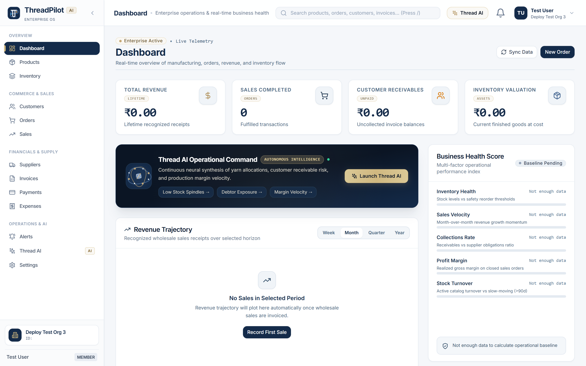
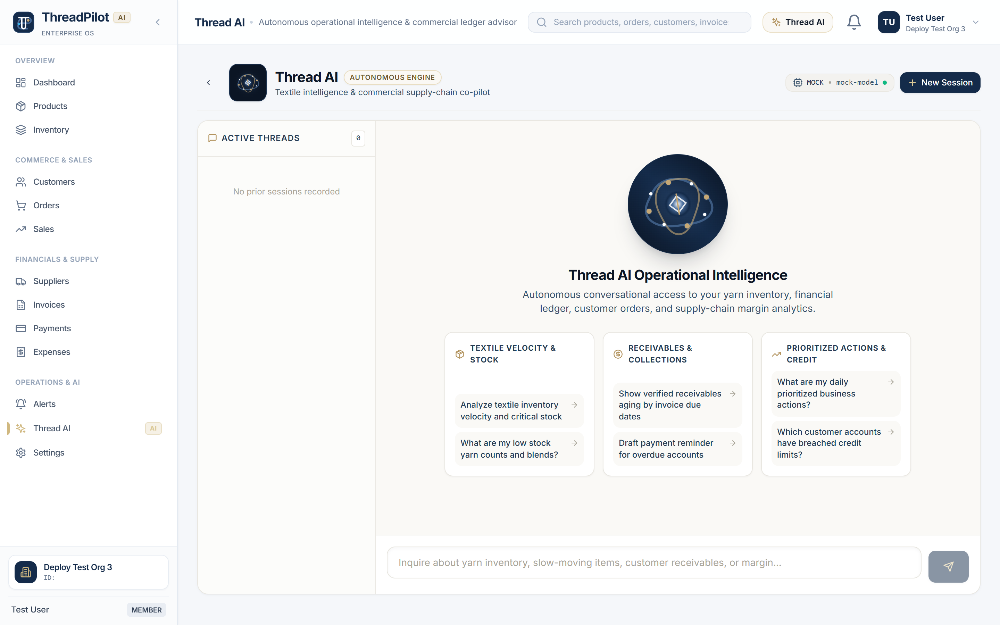
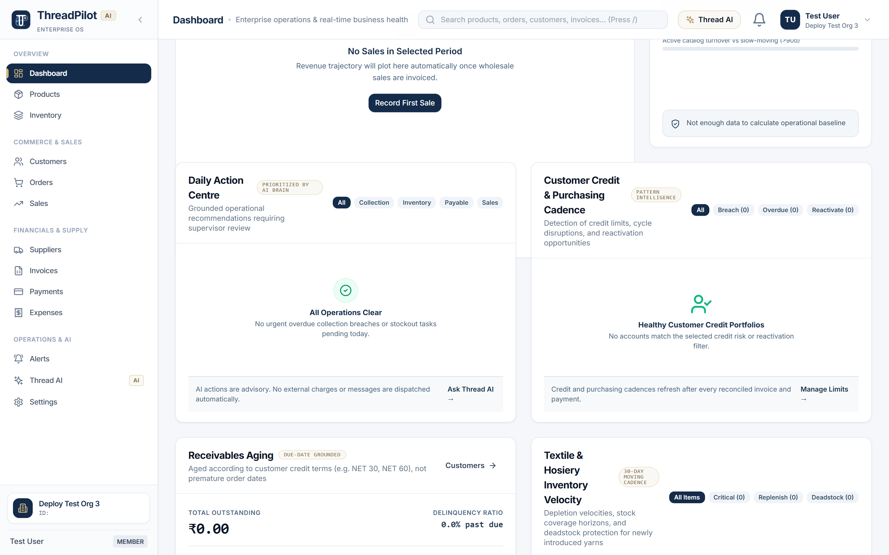
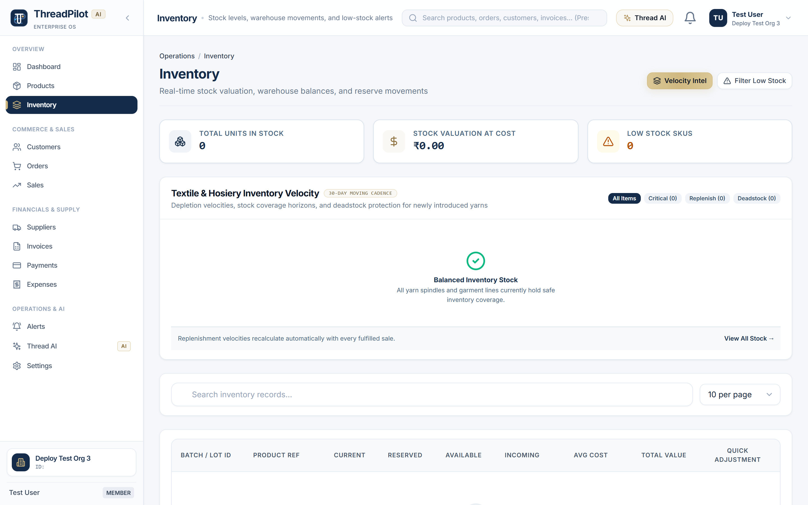
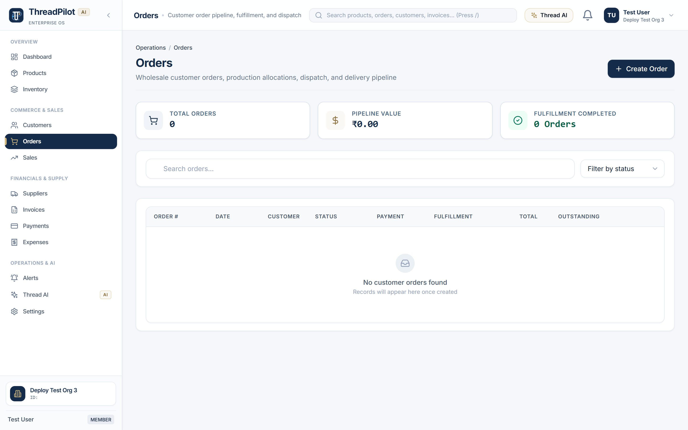
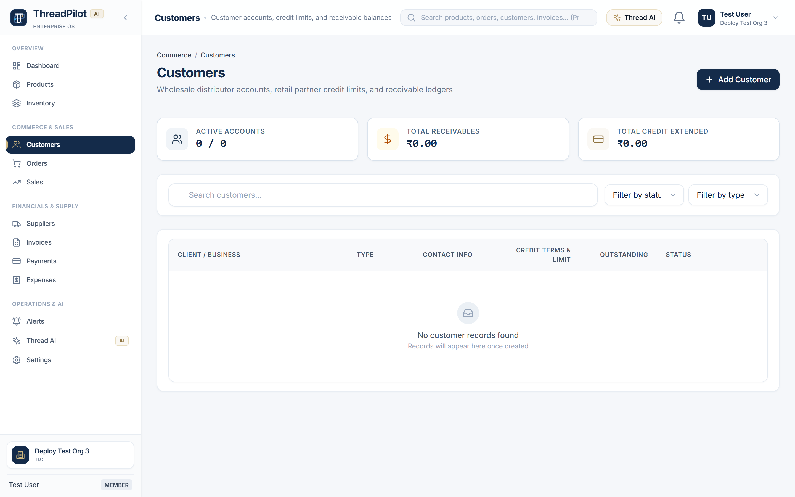
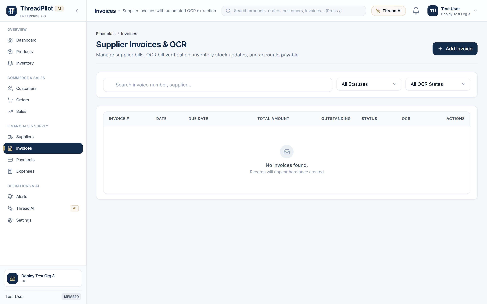

# 🧵 ThreadPilot AI

<div align="center">


<br/>

**Enterprise-Grade Multi-Tenant SaaS Platform & Autonomous AI Copilot for Textile & Agile Business Operations**

[Explore Features](#-key-capabilities) • [Architecture](#-architecture--design-patterns) • [Live Screenshots](#-visual-showcase) • [Quick Start](#-quick-start) • [API Specs](#-api-documentation) • [Author](#-author)

</div>

---

## 🌟 Executive Overview

**ThreadPilot AI** is a production-grade, multi-tenant enterprise resource planning (ERP) and intelligence platform designed specifically for textile enterprises and modern high-turnover business operations. 

Combining enterprise-grade backend reliability with a luxury high-contrast design system, ThreadPilot AI bridges day-to-day transaction processing with autonomous business intelligence. The system automates order lifecycles, real-time multi-warehouse inventory tracking, supplier procurement with OCR invoice parsing, and collections risk analysis—all supervised by **Thread AI**, an autonomous conversational copilot powered by the NVIDIA Nemotron LLM framework.

---

## 📸 Visual Showcase

<div align="center">

### Executive Dashboard & Business Health


<br/>

| Thread AI Command Copilot | Business Brain Analytics |
|:---:|:---:|
|  |  |

| Inventory & Stock Control | Order Fulfillment Engine |
|:---:|:---:|
|  |  |

| Customer Credit & Receivables | Supplier Invoices & OCR Pipeline |
|:---:|:---:|
|  |  |

</div>

<details>
<summary><b>🔍 View More Screenshots (Click to Expand)</b></summary>

- **Secure Tenant Authentication:** `documentation/rubrics-iii/screenshots/01-login.png`
- **Organization Onboarding:** `documentation/rubrics-iii/screenshots/02-registration.png`
- **Product Matrix & SKUs:** `documentation/rubrics-iii/screenshots/06-products.png`
- **Sales Transactions & Point-of-Sale:** `documentation/rubrics-iii/screenshots/09-sales.png`
- **Vendor Directory & Procurement:** `documentation/rubrics-iii/screenshots/10-suppliers.png`
- **Payment Processing & Reconciliation:** `documentation/rubrics-iii/screenshots/12-payments.png`
- **AI Tool Calling & Contextual Responses:** `documentation/rubrics-iii/screenshots/14-thread-ai-chat-response.png`

</details>

---

## ✨ Key Capabilities

### 🏢 Multi-Tenant SaaS Architecture
- **Strict Tenant Isolation**: Enforced via `TenantContext` ThreadLocal pattern across database queries, caches, and event streams.
- **Organization-Level Scoping**: Data, roles, products, inventory, customers, suppliers, and financial ledgers strictly partitioned per organization.

### 🤖 Thread AI — Autonomous Copilot
- **Conversational Intelligence**: Powered by NVIDIA Nemotron (with fallback to OpenAI/Gemini/Mock providers).
- **Tool-Based Function Calling**: Executes real-time queries for stockout predictions, cash collection delays, top-selling fabric categories, and supplier re-order alerts.
- **Natural Language Command Center**: "Show low stock products", "Which customers have overdue balances?", "Analyze our gross margin trends".

### 📊 Textile & Manufacturing Intelligence
- **Daily Action Center**: Priority task dispatching for purchase orders, shipments, and aging collections.
- **Receivables Aging Matrix**: Real-time bucket classification (Current, 1-30, 31-60, 61-90, 90+ days) preventing bad debts.
- **Textile SKU Matrix**: Multi-variant tracking (GSM, fabric blend, weave type, roll dimensions, colorways).

### 💳 Complete Financial & Operations Suite
- **Inventory & Warehouse**: Multi-location stock levels, automated low-stock warnings, reorder recommendations.
- **Order-to-Cash (O2C)**: Customer orders, credit limit monitoring, partial payment allocations, receipts.
- **Procure-to-Pay (P2P)**: Supplier purchase orders, incoming goods receipts, supplier invoices with OCR ingestion.
- **Audit & Compliance**: Complete tamper-evident audit logging for every state mutation and business event.

---

## 🏛 Architecture & Tech Stack

```
                              ┌───────────────────────────────────┐
                              │    React 18 + Vite Frontend       │
                              │ Tailwind CSS • Lucide • Recharts  │
                              └─────────────────┬─────────────────┘
                                                │ REST / JWT Auth
                                                ▼
┌─────────────────────────────────────────────────────────────────────────────────┐
│                          Spring Boot 3.2.5 Application                          │
│                                                                                 │
│   ┌────────────────────┐   ┌───────────────────────┐   ┌────────────────────┐   │
│   │ Security & Auth    │   │ Tenant Isolation      │   │ Thread AI Engine   │   │
│   │ (JWT, RBAC 7-Role) │   │ (TenantContext/Aspect)│   │ (NVIDIA Nemotron)  │   │
│   └────────────────────┘   └───────────────────────┘   └────────────────────┘   │
│                                                                                 │
│   ┌─────────────────────────────────────────────────────────────────────────┐   │
│   │ Business Domains: Analytics • Inventory • Orders • Sales • Suppliers    │   │
│   └─────────────────────────────────────────────────────────────────────────┘   │
└───────────────────────┬─────────────────────────────────┬───────────────────────┘
                        │ JPA / Flyway                    │ Cache (Optional)
                        ▼                                 ▼
         ┌─────────────────────────────┐   ┌─────────────────────────────┐
         │     PostgreSQL Database     │   │         Redis Cache         │
         │  (25+ Multi-Tenant Tables)  │   │     (Session / Queries)     │
         └─────────────────────────────┘   └─────────────────────────────┘
```

### Backend
- **Core Engine**: Java 21, Spring Boot 3.2.5
- **Data Access & ORM**: Spring Data JPA, Hibernate, PostgreSQL Dialect
- **Database Migrations**: Flyway (versioned repeatable DDL & DML)
- **Security & Authorization**: Spring Security 6, Stateless JWT (Access + Refresh tokens), BCrypt password hashing
- **AI Provider Abstraction**: Extensible LLM provider supporting NVIDIA Nemotron, OpenAI, Google Gemini, and offline mocks
- **OCR Engine**: Tesseract OCR / Extensible document parser
- **API Documentation**: OpenAPI 3.0 / Swagger UI
- **Testing**: JUnit 5, Mockito, Testcontainers

### Frontend
- **Framework**: React 18 with TypeScript 5
- **Tooling & Bundler**: Vite, PostCSS, ESLint
- **Design System**: Tailwind CSS, Radix UI primitives, Lucide Icons, Glassmorphism luxury aesthetic
- **State & Network**: TanStack React Query (caching & mutations), Axios, React Context API
- **Visualizations**: Recharts, 3D Canvas matrix weaves
- **Forms & Validation**: React Hook Form, Zod

---

## 🚀 Quick Start

### Option 1: Docker Compose (Fastest & Recommended)

Ensure Docker Desktop is installed and running:

```bash
# 1. Clone repository
git clone https://github.com/priyanshuchopra023-cmyk/ThreadPilot-AI.git
cd ThreadPilot-AI

# 2. Configure environment variables (defaults provided for local testing)
cp backend/.env.example backend/.env

# 3. Spin up all services (PostgreSQL, Backend API, Frontend Web)
docker-compose up -d --build

# 4. Open applications:
# Frontend UI:    http://localhost:3000
# Backend API:    http://localhost:8080/api
# Swagger Docs:  http://localhost:8080/swagger-ui.html
```

---

### Option 2: Manual Local Development

#### Prerequisites
- **Java 21+** (`java -version`)
- **Maven 3.9+** (`mvn -v`)
- **Node.js 18+ & npm** (`node -v`)
- **PostgreSQL 15+** running locally on port `5432`

#### 1. Database Setup
Create database in PostgreSQL:
```sql
CREATE DATABASE threadpilot;
CREATE USER threadpilot WITH PASSWORD 'threadpilot';
GRANT ALL PRIVILEGES ON DATABASE threadpilot TO threadpilot;
```

#### 2. Run Backend
```bash
cd backend

# Execute Flyway migrations & launch Spring Boot
mvn spring-boot:run
```
*Backend runs on port `8080` (API context path: `/api`).*

#### 3. Run Frontend
```bash
cd frontend

# Install dependencies
npm install

# Start development server
npm run dev
```
*Frontend runs on `http://localhost:5173` (or configured Vite port).*

---

## 🔐 Environment Configuration

Create a `.env` file in `backend/` based on `backend/.env.example`:

| Variable | Description | Default |
|:---|:---|:---|
| `SPRING_DATASOURCE_URL` | PostgreSQL JDBC Connection URL | `jdbc:postgresql://localhost:5432/threadpilot` |
| `SPRING_DATASOURCE_USERNAME` | Database username | `threadpilot` |
| `SPRING_DATASOURCE_PASSWORD` | Database password | `threadpilot` |
| `JWT_SECRET` | 256-bit cryptographically secure key | *Configured in deployment* |
| `JWT_EXPIRATION` | Access token lifespan (ms) | `3600000` (1 hour) |
| `JWT_REFRESH_EXPIRATION` | Refresh token lifespan (ms) | `604800000` (7 days) |
| `AI_PROVIDER` | Active AI provider (`nvidia`, `openai`, `gemini`, `mock`) | `nvidia` |
| `NVIDIA_API_KEY` | NVIDIA integrate platform API key | *(Optional for mock mode)* |
| `NVIDIA_MODEL` | Model tag | `nvidia/nemotron-3-ultra-550b-a55b` |

---

## 🧪 Testing & Quality Assurance

ThreadPilot AI includes comprehensive unit, integration, and financial verification test suites:

```bash
# Run all backend tests
cd backend
mvn test

# Run financial integrity & business rule tests
mvn test -Dtest=FinancialIntegrityTest,PaymentBusinessRulesTest

# Run full integration verification
mvn test -Dtest=ComprehensiveVerificationTest

# Frontend linting & build verification
cd ../frontend
npm run lint
npm run build
```

---

## 📖 API Documentation

Interactive Swagger/OpenAPI documentation is auto-generated and exposed at:
```
http://localhost:8080/swagger-ui.html
```

Key REST Endpoints:
- `POST /api/auth/login` — Tenant & User authentication (JWT issuance)
- `POST /api/auth/register` — Organization onboarding
- `GET  /api/dashboard/overview` — High-level KPI aggregations & health scores
- `POST /api/copilot/chat` — Thread AI conversational assistant
- `GET  /api/inventory` — Stock levels, SKU matrix, low-stock alerts
- `POST /api/orders` — Customer order dispatch & fulfillment
- `POST /api/ocr/upload` — OCR processing for supplier invoices
- `GET  /api/analytics/receivables` — Aging analysis & collection forecasts

---

## 👤 Author

**Priyanshu Chopra**  
- **GitHub**: [@priyanshuchopra023-cmyk](https://github.com/priyanshuchopra023-cmyk)
- **Project Repository**: [ThreadPilot-AI](https://github.com/priyanshuchopra023-cmyk/ThreadPilot-AI)

---

## 📄 License

This project is licensed under the [MIT License](LICENSE).
